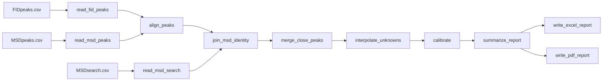

# fidms

R replacement for the `Automated Polyarc.xlsm` VBA workflow: turns Agilent
GC-FID and GC-MSD peak exports into the client-facing Total Compound Report and
Summary Report.

## Pipeline



## Usage

```r
library(fidms)

info <- sample_info(
  sample_id = "Diesel-1", sample_name = "Pyrolysis oil", project_code = "MD",
  analyst = c("nrn", "pbulsink"), density = 0.8519,
  methanol_wt_pct = 0, water_wt_pct = 0, dilution = 1
)

result <- process_sample(
  "FIDpeaks.csv", "MSDpeaks.csv", "MSDsearch.csv",
  info = info, style = "slope"
)

write_excel_report(result)   # MD_diesel_GC-MS-FID.xlsx
write_pdf_report(result)     # MD_diesel_GC-MS-FID.pdf (needs Quarto + LaTeX)
```

Or run the local Shiny front end:

```r
fidms::run_app()
```

The app is **local only** by design — client sample data must not be uploaded
to any hosted service.

## Mapping from the macro

| VBA | R |
| --- | --- |
| `CleanPeakTables` | `read_fid_peaks()`, `read_msd_peaks()`, `read_msd_search()` |
| `Lookup`, `Bump_Signal_Down` | `find_rt_shift()`, `align_peaks()`, `join_msd_identity()` || `Collapse_Rows` | `merge_close_peaks()` |
| `Interpolate` | `interpolate_unknowns()` |
| `Calibrate`, `frmCalType` | `fit_calibration()`, `calibrate()` |
| `frmSuggested`, `frmBrowse`, `PeakApprove` | `suggest_reference_peak()`, `reference_peak_ok()`, peak-browser table |
| `Report`, `ChemicalFamily` | `classify_family()`, `summarize_report()`, `write_excel_report()` |
| `ChemRegex`, `molweight`, `PeriodicTable` | `parse_formula()`, `molecular_weight()`, `atomic_weights` |
| `RICal` sheet | `rical_reference_points`, `fit_retention_index()` |
| `PARAM` sheet | `fidms_params()` |

## Lookup data

`data-raw/lookup_tables.R` rebuilds the packaged tables from `caltable.csv` and
`rical.csv`. Two deliberate departures from the workbook, per `plan.md`:

- The stored degree-6 RI polynomial and the stored calibration coefficients/R²
  are **not** ported; both are refit at runtime from the reference points.
- Calibration levels with a zero response are below-detection points with no
  calibration-curve entry, and are excluded from the fit rather than treated as
  observed zeros.

## Alignment engines

`align_peaks()` and `process_sample()` take `engine = "grid"` (default) or
`engine = "gcalignr"`.

- **`grid`** is a direct port of the VBA `Lookup`/`Bump_Signal_Down` pair: a
  brute-force linear-shift search followed by one-to-one greedy nearest-neighbour
  matching. Fast, deterministic, and the closest match to the macro's behaviour.
- **`gcalignr`** delegates to `GCalignR::align_chromatograms()`, which applies
  the same linear-shift step but then groups peaks row-wise against a running
  mean. Use this as peak lists grow or when more than two detectors/samples need
  aligning together — the grouping handles split and merged peaks more
  gracefully than a single nearest-neighbour pass.

The two engines are **not expected to agree exactly**, and on the 10-peak sample
excerpt they do not: the grid engine finds a shift of +0.005 min and pairs FID
peak 1, while GCalignR finds -0.06 min and instead pairs FID peak 10. With only
ten closely spaced peaks the shift is poorly constrained, so this excerpt cannot
say which is right. Compare both on a full sample before choosing a default for
production.

## Quantitation and the Polyarc response model

The Polyarc reactor converts all eluting carbon to methane before the flame, so
FID area is proportional to *moles of carbon* regardless of compound. Mass is
therefore proportional to area times molar mass divided by carbon number, which
is exactly the ratio the workbook applied to every uncalibrated peak:

$$A_i = A_t \cdot \frac{F_i}{F_t} \cdot \frac{C_t}{C_i} \cdot \frac{M_i}{M_t}$$

for FID area $F$, carbon count $C$ and molar mass $M$, where $t$ is the peak's
governing calibration target. `calibrate()` implements this in
`polyarc_ratio()`.

Peaks are governed by the nearest *preceding* matched target of their own type
(oxygenate if the formula contains oxygen, hydrocarbon otherwise) — the
approximate-match `VLOOKUP` behaviour of the workbook's `Closest Target Row`
column, reproduced in `assign_target_rows()`. Target peaks themselves are
quantified from their own curve, clamped at zero.

With no calibration targets in the sample, external calibration is impossible
and `calibrate()` errors, directing you to `style = "internal"`. That path
reproduces the macro's fallback: a relative molar response factor against a
reference peak, normalised so the peaks account for 100% of sample mass. It
assumes complete recovery and needs no reference concentration.

`calibration_recovery()` reports GC and total recovery for all four styles, as
`frmCalType` did, so curve forms can be compared before committing.

## Internal-standard reference peak

`prepare_peaks()` runs everything up to but not including quantitation, so a
reference peak can be proposed and reviewed before a calibration style is
applied — the role `frmSuggested` played before `Calibrate` ran.
`suggest_reference_peak()` proposes the largest-area peak and reports its area
percent, MS score and name; if that peak fails `reference_peak_ok()` it falls
back to the largest *qualifying* peak rather than dropping the analyst straight
into a browse list. The Shiny peak-browser table pre-selects the suggestion and
accepts any other row as an override.

`reference_peak_ok()` ports `PeakApprove()`: a peak qualifies only if it has an
MS library name and a match score of at least 30 (which also excludes
interpolated and extrapolated peaks), is not a combined FID peak, contains no
halogen, boron, phosphorus or silicon (O, N and S are fine), and accounts for
at least 0.001% of total FID area. The heteroatom rule matters in practice —
on the sample excerpt it rejects dichloromethane despite its 22% area share and
99.2 match score.

## Open items

- Decide the production default alignment engine by comparing `grid` and
  `gcalignr` on a full real sample.
- Peak-table pagination in the PDF for 500+ peak samples is handled by
  `longtable`; review against a real full-size render.
- Golden-file regression against the macro's output for a full real sample
  (work breakdown item 10) is not yet done — the sample CSVs in the repo are
  10-peak excerpts, not the full run behind `MD_diesel_GC-MS-FID.xlsx`.
- Deferred: calibration-report import and local persistence (item 12).
