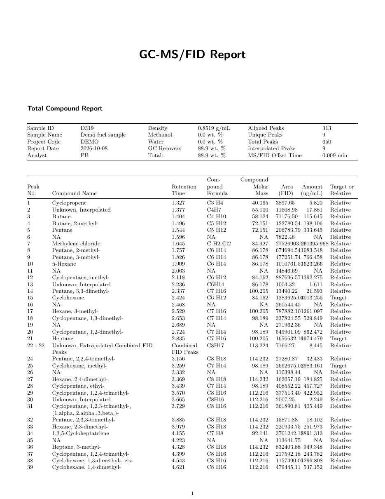
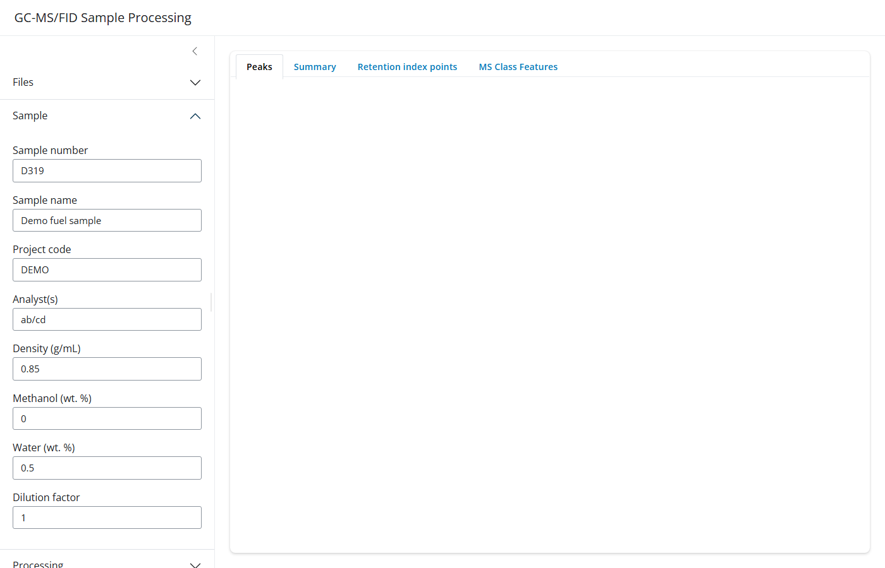
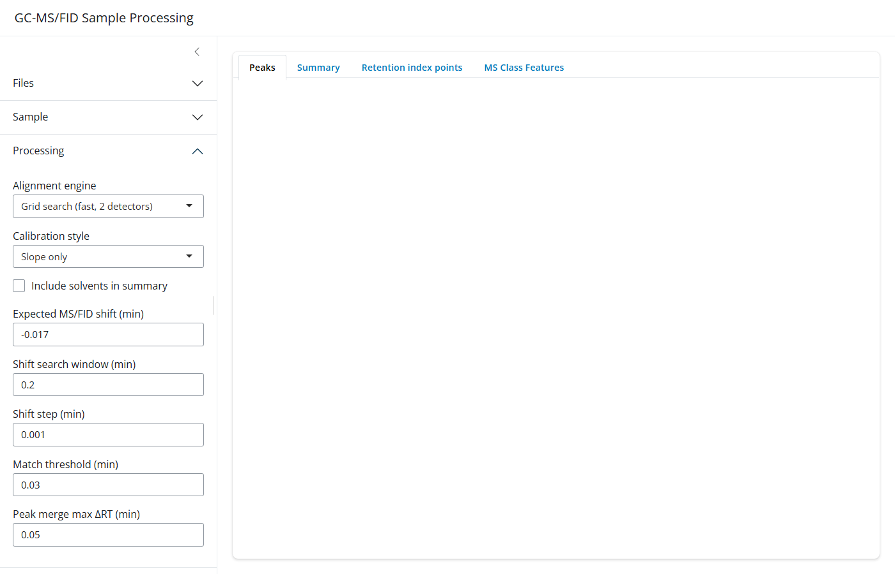
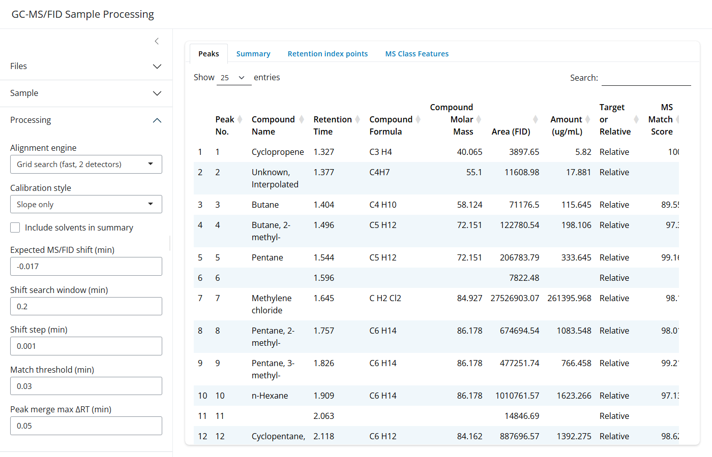
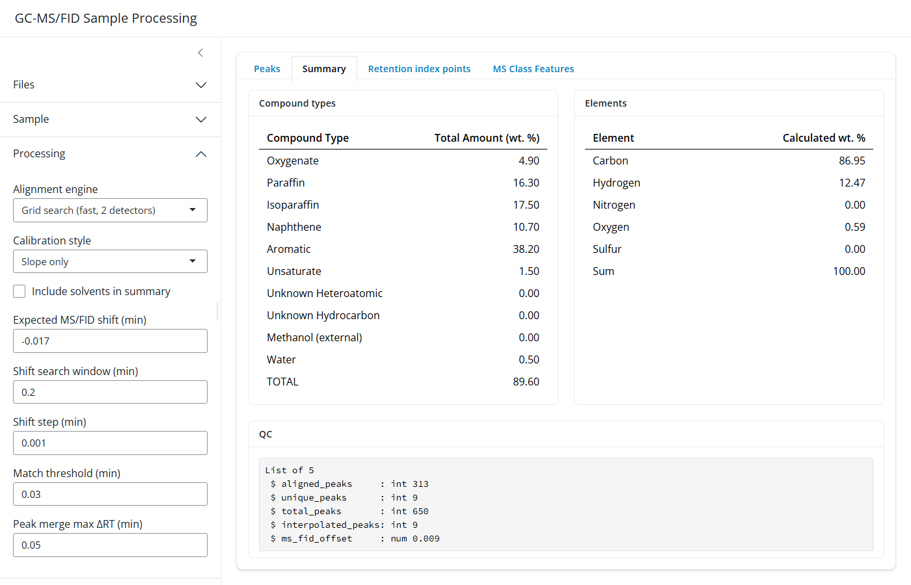
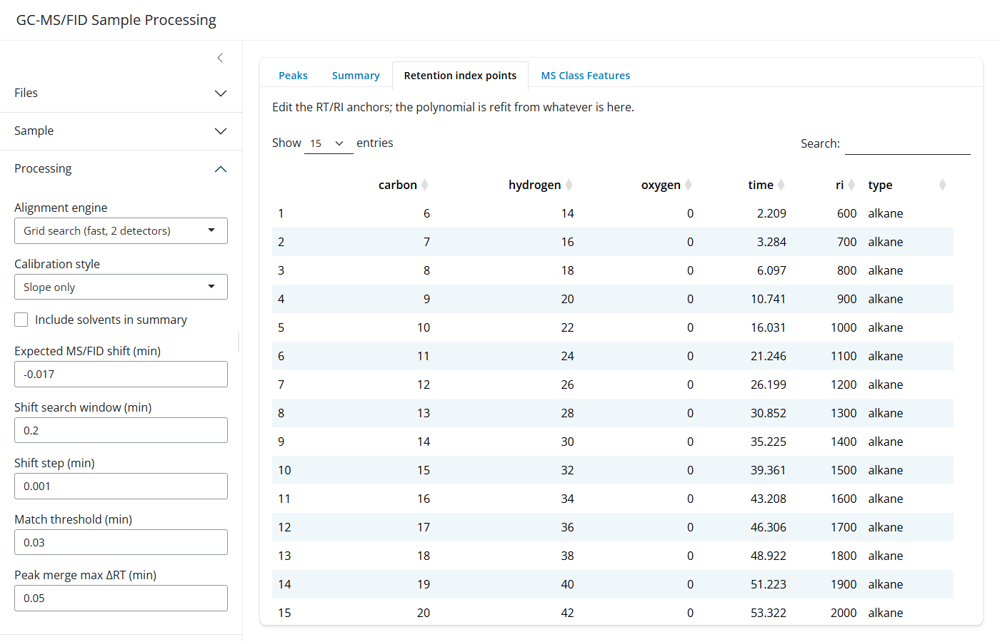
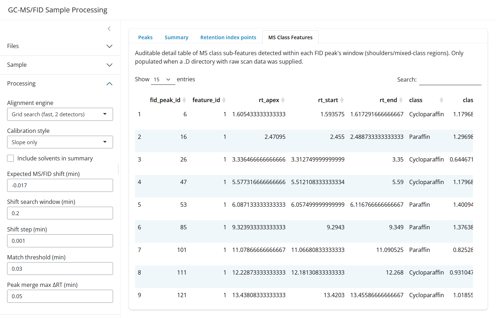

```{r setup, include = FALSE}
knitr::opts_chunk$set(collapse = TRUE, comment = "#>", fig.width = 6, fig.height = 4)

# The three peak-table CSVs ship with the vignette. The raw scan file
# (data.ms) is large client data kept outside the package, so the class-ion
# section only runs when the original .D directory can be found.
d_dir <- Sys.getenv("FIDMS_D319", unset = "")
if (!nzchar(d_dir)) {
  candidates <- c("../D319.D", "D319.D")
  d_dir <- candidates[dir.exists(candidates)][1]
}
have_raw <- !is.na(d_dir) && file.exists(file.path(d_dir, "data.ms"))
library(fidms)
```

## The problem

A fuel or process sample leaves the instrument as three separate things: an FID
peak table (quantitative, but anonymous), an MSD peak table (identified, but
on a slightly different time axis), and a library-search export that names the
MSD peaks. A client wants one table of compounds with amounts, plus a summary of
chemical families and elements.

`fidms` replaces the old "Automated Polyarc" Excel/VBA macro for this job. This
vignette follows one real sample, `D319`, end to end, first in code and then
through the local Shiny app. Along the way it points out each place where the
analyst has to supply something the instrument files cannot know.

## What goes in

The three exports `fidms` reads are bundled with this vignette as CSV files,
copied from the Agilent `D319.D` data directory. The raw `data.ms` scan file in
that directory enables the optional hydrocarbon-class analysis; it is not
bundled, so that section only runs where the `.D` directory is available.

```{r inputs}
fid_csv    <- "FIDpeaks.csv"
msd_csv    <- "MSDpeaks.csv"
search_csv <- "MSDsearch.csv"

file.exists(c(fid_csv, msd_csv, search_csv))
```

Only the three CSVs are required; the raw scans are additive.

## Sample properties only the analyst knows

Several numbers feed directly into the reported weight percents, and none of
them are in the instrument files:

| Property | Why it is needed |
|----------|------------------|
| Sample number, name, project code, analyst(s) | Report headers and output file name |
| Density (g/mL) | Converts $\mu$g/mL to weight percent |
| Methanol and water (wt. %) | Measured separately (e.g. Karl Fischer); reported alongside the GC result so totals can approach 100 |
| Dilution factor | Corrects amounts for any dilution before injection |

```{r sample-info}
info <- fidms:::.sample_info(
  sample_id       = "D319",
  sample_name     = "Demo fuel sample",
  project_code    = "DEMO",
  analyst         = "PB",
  density         = 0.8519,
  methanol_wt_pct = 0,
  water_wt_pct    = 53 / 1e4, # 53 ppm = 0.0053 wt. %
  dilution        = 1
)
info$analyst
```

The metadata constructor is internal, because the Shiny app is its main caller;
in code you build it directly. Multiple analysts are joined with a slash. The density
and water content are the measured values for this sample; water is entered in
weight percent, so 53 ppm becomes 0.0053.

## Processing in code

### Alignment and identification

`prepare_peaks()` is the first half of the pipeline. It parses the files, finds
the time offset between the FID and MSD detectors, matches peaks across them,
attaches library identities, merges split peaks and fills in formulae for
unidentified peaks by interpolation.

```{r prepare}
prep <- prepare_peaks(fid_csv, msd_csv, search_csv)
c(peaks = nrow(prep$peaks), shift_min = prep$shift)
table(prep$peaks$origin)
```

The search found an MS-to-FID offset of `r round(prep$shift, 3)`
minutes, which is small. Most peaks align to an MSD
peak; the few `interpolated` and `extrapolated` ones have no library identity,
so their formulae are estimated from neighbours. Those are the rows to treat
with the most caution in a client report.

### Optional: hydrocarbon classes from raw scans

When the raw `data.ms` is available, the ASTM D2425 class-ion deconvolution can
assign hydrocarbon classes to peaks the library could not name, instead of
leaving them to interpolation. These helpers are internal; the Shiny app calls
them for you whenever you give it a `.D` directory.

```{r class-ions, eval = have_raw}
scan_matrix  <- fidms:::.read_ms_scan_matrix(d_dir)
class_traces <- fidms:::.build_class_ion_traces(scan_matrix)

prep_cls <- prepare_peaks(
  fid_csv, msd_csv, search_csv,
  class_traces = class_traces,
  scan_matrix  = scan_matrix
)
table(prep_cls$peaks$assignment_tier, useNA = "ifany")
```

The assignment tiers record how much evidence supports each peak (library hit,
class-ion solve, mixed region, or none). Reading the raw scan file takes several
seconds, which is why this step is opt-in.

### Quantitation

Calibration is the second half. The default `style = "slope"` uses the packaged
calibration table for compounds with targets and a Polyarc relative response
for everything else. Dilution and density come from the sample metadata.

```{r prep-fallback, include = FALSE, eval = !have_raw}
prep_cls <- prep
```

```{r quantify}
peaks <- calibrate(
  prep_cls$peaks,
  style    = "slope",
  dilution = info$dilution,
  density  = info$density
)
res <- summarize_report(peaks, info, shift = prep_cls$shift)
res$totals[c("gc_recovery", "total")]
```

GC recovery is the sum of the quantified, non-solvent compounds in weight
percent. A value well below 100 after adding methanol and water would suggest
undetected material, so the number is worth comparing with expectations for the
sample type rather than accepting automatically.

### Internal-standard quantitation

If the sample contains a compound that can serve as an internal reference,
`style = "internal"` normalises the sample to 100% against it. Choosing that peak
is a judgement call, so `fidms` proposes one and checks its quality.

```{r internal-standard}
ref <- fidms:::.suggest_reference_peak(prep_cls$peaks)
ref[c("peak_index", "name", "area_percent", "score", "approved")]
```

Here the suggestion is the largest peak that passes the quality check (a good
library match and a reasonable share of the total area). `approved` is `TRUE`
when the largest peak itself qualified; otherwise the next best qualifying peak
is offered. The analyst may override it by choosing any other peak index.

```{r internal-quant}
peaks_is <- calibrate(
  prep_cls$peaks,
  style          = "internal",
  reference_peak = ref$peak_index,
  dilution       = info$dilution,
  density        = info$density
)
res_is <- summarize_report(peaks_is, info, shift = prep_cls$shift)
round(res_is$totals$gc_recovery, 1)
```

The internal-standard recovery differs from the slope-style result, because
amounts are now scaled relative to the reference peak rather than from the
calibration curves. Here the reference is a library-identified methyl ester
making up a few percent of the total area, so the result depends on how well
that one peak represents the sample. Comparing the two recoveries is a useful
sanity check on the choice of reference.

### Reading the summary

```{r family-plot}
fam <- res$families
fam <- fam[fam$wt_pct > 0, ]
op <- par(mar = c(4, 9, 1, 1))
barplot(rev(fam$wt_pct), names.arg = rev(fam$compound_type), horiz = TRUE,
        las = 1, xlab = "wt. %")
par(op)
```

The sample is dominated by aromatics and the hydrocarbon families, with a
smaller oxygenate fraction. Families are assigned programmatically from formulae
and names, so the compound types are indicative and, as the report notes
state, not a substitute for a standard PIONA analysis.

The per-compound table that the client sees is built by
`total_compound_table()`:

```{r total-table}
tc <- total_compound_table(res, include_class_ion = TRUE)
head(tc[, c("Peak No.", "Compound Name", "Retention Time",
            "Area (FID)", "Amount (ug/mL)")], 8)
```

Unmatched peaks have no compound name, and combined peaks print the sentinel
`"Combined FID Peaks"` instead of a retention time, which is why that column is
character.

## Writing the reports

Both writers take the summarised result. The Excel report has a Total Compound
sheet and a Summary sheet.

```{r excel-report}
xlsx <- write_excel_report(res, file.path(tempdir(), "DEMO_D319_GC-MS-FID.xlsx"))
openxlsx::getSheetNames(xlsx)
```

The PDF report is rendered from a Quarto template, so it needs Quarto and a
LaTeX engine installed. The chunk below is not evaluated when the vignette is
built; the image after it is the first page of the report produced from this
sample.

```{r pdf-report, eval = FALSE}
write_pdf_report(res, "DEMO_D319_GC-MS-FID.pdf")
```



The header block repeats the sample metadata and the headline numbers (GC
recovery, peak counts, MS/FID offset), so a reader can check the report against
the inputs without opening anything else. Compounds without a library identity
show as `NA`. The remaining pages continue the compound table and end with the
Summary Report.

## The same workflow in the Shiny app

Everything above is available through a local Shiny app. It runs on your
machine and is not meant for deployment, so client data stays local.

```{r run-app, eval = FALSE}
fidms::run_app()
```

The app needs `shiny`, `bslib` and `DT`. The screenshots below were captured
from a real run on `D319.D`.

### 1. Point the app at the data


Enter the `.D` directory and the app uses the CSVs found inside it, and also
reads `data.ms` for the hydrocarbon-class analysis. Uploaded CSVs take
precedence over files in the directory.

### 2. Enter the sample properties



This is the same information as the metadata object in code. The sample number
is required; processing does not start without it.

### 3. Choose processing options



The defaults reproduce the macro's behaviour. The alignment engine (`grid` or
`gcalignr`) and the shift parameters correspond to `fidms_params()`. The two
engines are not expected to agree exactly, and the production default is still
an open question. Choosing **Internal standard** adds a panel showing the
suggested reference peak, which you can override by selecting a row in the
Peaks tab.

### 4. Process and review the peaks



Pressing **Process sample** runs the same steps as the code above. The Peaks
table is the Total Compound table; with a `.D` directory it also carries the
class-ion columns to the right.

### 5. Check the summary



These are the numbers that go on the Summary Report. They match the code-based
result because both paths call the same functions.

### 6. Retention-index anchors and class features



The retention-index model is refit at run time from these anchors, so editing a
point changes how library hits are cross-checked.



This audit table is only populated when raw scan data was supplied.

### 7. Download the reports

The **Excel report** and **PDF report** buttons call `write_excel_report()` and
`write_pdf_report()` on the current result, named
`{project code}_{sample number}_GC-MS-FID`.

## Summary

The workflow is `prepare_peaks()`, then `calibrate()`, then
`summarize_report()`, then a report writer; the app wraps the same sequence.
The inputs to supply yourself are the sample metadata (density, methanol, water,
dilution), the calibration style, and, for internal standardisation, the
reference peak. Worth checking by eye: interpolated peaks, GC recovery, and the
choice of alignment engine.

Screenshots are generated by `data-raw/capture_app_screenshots.R`; rerun it
after any UI change.
